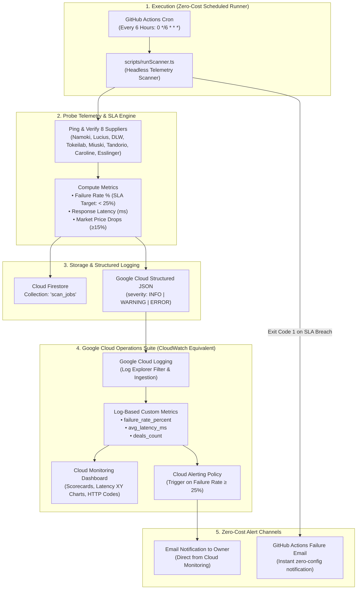

# DialForge: Scanner Telemetry, Cloud Monitoring & Alerting Guide

This guide details how DialForge tracks supplier feed health, latency, failure rates, and deals using **Firebase and Google Cloud Operations Suite (Cloud Monitoring & Cloud Logging)** — the exact Google Cloud equivalent of **AWS CloudWatch**.

The public website ([`src/App.tsx`](../src/App.tsx)) remains 100% focused on the watch building experience with zero operational clutter. All metrics, dashboards, and alerting policies run in the cloud and are managed through the **Firebase Console** and **Google Cloud Console**.

---

## 1. Firebase / Google Cloud vs. AWS CloudWatch Mapping

Because every Firebase project is backed by a native Google Cloud project under the same Project ID, you have full access to Google Cloud's enterprise operations suite:

| AWS CloudWatch Component | Firebase / Google Cloud Counterpart | Console Location |
| :--- | :--- | :--- |
| **CloudWatch Metrics** | **Google Cloud Monitoring Metrics** | `console.cloud.google.com/monitoring/metrics-explorer` |
| **CloudWatch Dashboards** | **Google Cloud Monitoring Dashboards** | `console.cloud.google.com/monitoring/dashboards` |
| **CloudWatch Logs** | **Google Cloud Logging (Stackdriver)** | `console.cloud.google.com/logs-viewer` |
| **CloudWatch Alarms** | **Cloud Monitoring Alerting Policies** | `console.cloud.google.com/monitoring/alerting` |
| **CloudWatch Metric Filters** | **Log-Based Metrics** | `console.cloud.google.com/logs-viewer/metrics` |
| **SNS Notification Topics** | **Notification Channels (Email, Slack, Webhooks)** | `console.cloud.google.com/monitoring/alerting/notifications` |
| **DynamoDB Telemetry Table** | **Cloud Firestore (`scan_jobs` Collection)** | `console.firebase.google.com` ➔ Firestore Database |

---

## 2. Telemetry Architecture & Data Flow



---

## 3. Cost Economics: $0.00/Month (100% Free Tier)

All telemetry and alerting tools operate within Google Cloud and GitHub free allowances:

1. **Google Cloud Logging**:
   * **Free Quota**: First **50 GiB per project per month** is free.
   * **DialForge Usage**: Scanning 4 times per day produces ~15 KiB/month (< 0.0001% of free quota).
2. **Google Cloud Monitoring**:
   * **Free Quota**: All standard metrics are free. First **150 MiB of custom metric data** per month is free.
   * **Dashboards**: 100% free (unlimited custom dashboards).
   * **Alerting**: Unlimited free email notification channels.
3. **GitHub Actions Cron**:
   * **Free Quota**: **2,000 runner minutes per month** on public and private repositories.
   * **DialForge Usage**: Each scan job runs in ~2 seconds (total ~4 minutes/month).

**Total Monthly Cost:** **$0.00 / month**.

---

## 4. Google Cloud Logging Structured Format

Whenever the scanner runs, it automatically emits single-line structured JSON logs following the Google Cloud Logging specification:

```json
{
  "severity": "INFO",
  "message": "DialForge Scanner Job scan-1731640000 completed: COMPLETED with 0% failure rate and 28 deals detected.",
  "time": "2026-11-15T04:29:51.393Z",
  "logging.googleapis.com/labels": {
    "app": "dialforge",
    "component": "supplier-scanner",
    "environment": "production"
  },
  "jobId": "scan-1731640000",
  "durationMs": 1460,
  "status": "completed",
  "itemsMonitored": 59,
  "priceDropsDetected": 28,
  "failureRatePercent": 0,
  "successRatePercent": 100,
  "avgLatencyMs": 298,
  "sourcesTotal": 8,
  "sourcesSucceeded": 8,
  "sourcesFailed": 0,
  "alertTriggered": false,
  "supplierHealth": [
    { "sourceId": "src-namoki", "sourceName": "NamokiMODS (Global)", "status": "online", "statusCode": 200, "latencyMs": 217 },
    { "sourceId": "src-aliexpress-tandorio", "sourceName": "Tandorio Official (AliExpress)", "status": "online", "statusCode": 200, "latencyMs": 408 }
  ]
}
```

If the supplier failure rate reaches ≥ 25%, the log severity elevates to `"ERROR"`, an alert condition is flagged, and the script exits with status 1.

---

## 5. Deploying the Cloud Monitoring Dashboard

A ready-to-use CloudWatch-style dashboard definition is provided in [`monitoring/google-cloud-monitoring-dashboard.json`](../monitoring/google-cloud-monitoring-dashboard.json).

### Option A: 1-Command CLI Deployment (using `gcloud`)
If you have the Google Cloud SDK (`gcloud`) installed:
```bash
gcloud monitoring dashboards create \
  --config-from-file=monitoring/google-cloud-monitoring-dashboard.json
```

### Option B: Import via Google Cloud Console
1. Open the [Google Cloud Console Monitoring Dashboards](https://console.cloud.google.com/monitoring/dashboards).
2. Ensure your Firebase project is selected from the project dropdown at the top.
3. Click **+ Create Dashboard**.
4. In the top right toolbar, click **JSON Editor**.
5. Paste the contents of [`monitoring/google-cloud-monitoring-dashboard.json`](../monitoring/google-cloud-monitoring-dashboard.json) and click **Apply**.

---

## 6. Setting Up Alerts & Email Notifications

DialForge provides two complementary, zero-cost alert mechanisms:

### Method 1: Google Cloud Monitoring Alerting Policy
1. Deploy the alerting policy from [`monitoring/scanner-alert-policy.json`](../monitoring/scanner-alert-policy.json):
   ```bash
   gcloud alpha monitoring policies create \
     --policy-from-file=monitoring/scanner-alert-policy.json
   ```
2. In the Google Cloud Console under **Monitoring ➔ Alerting ➔ Notification Channels**:
   * Add your email address as a notification channel.
   * Attach the notification channel to the `DialForge Scanner SLA Breach` policy.
   * Google Cloud will dispatch an email whenever failure rates breach 25%.

### Method 2: GitHub Actions Automated Email Alerts (Zero Configuration)
* When the scanner detects that failure rate ≥ 25%, it writes an error annotation and terminates with `process.exit(1)`.
* This causes the GitHub Actions workflow job to fail.
* GitHub automatically dispatches an alert email to the repository owner (`nikhilgrover`) by default under GitHub notification settings.

---

## 7. Viewing Telemetry Directly in Firebase Console

Every scan run automatically persists a complete report into Cloud Firestore under the `scan_jobs` collection:

1. Open the [Firebase Console](https://console.firebase.google.com).
2. Select your project and navigate to **Build ➔ Firestore Database**.
3. Open the `scan_jobs` collection.
4. Each document contains:
   * `timestamp`: ISO timestamp
   * `status`: `completed`, `degraded`, or `failed`
   * `metrics`: `failureRatePercent`, `avgLatencyMs`, `sourcesTotal`, `sourcesFailed`
   * `sourceResults`: Per-supplier breakdown of HTTP status codes and latencies
   * `dealsDiscovered`: Price reductions found during that run

---

## 8. Testing Alerts Locally

You can simulate a supplier outage or rate limiting locally at any time:

```bash
# Run normal scan (0% failure rate)
npm run scanner

# Run simulation test (triggers HTTP 429 & 504 and tests alert rules)
npm run scanner -- --test-alert
```
